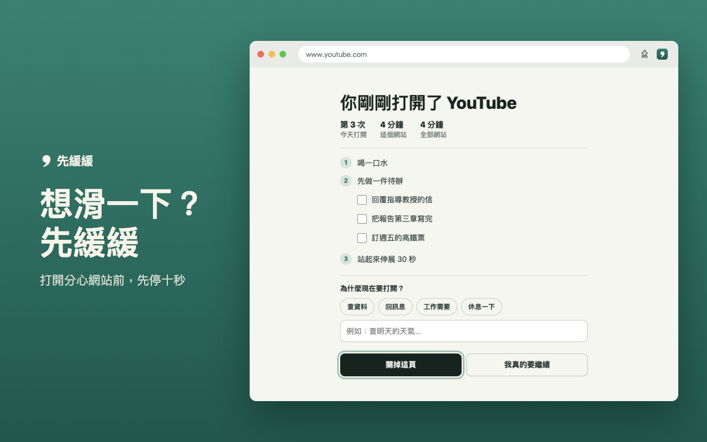
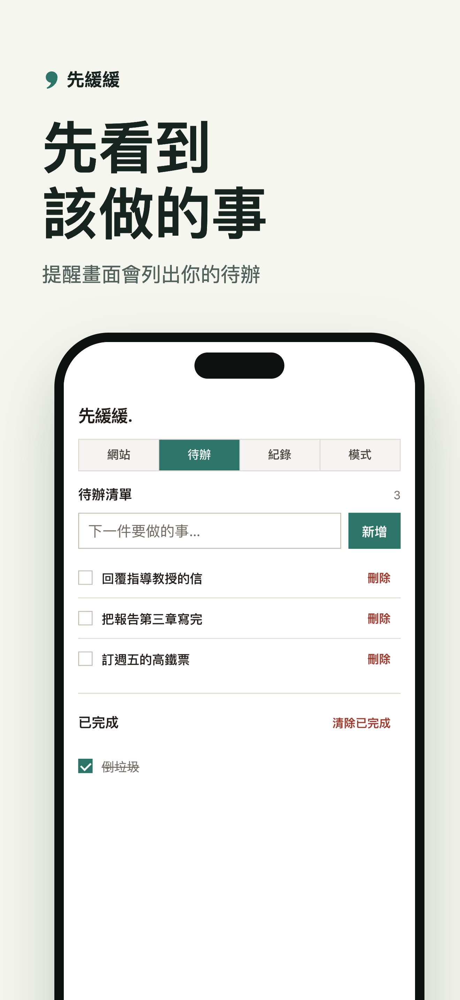
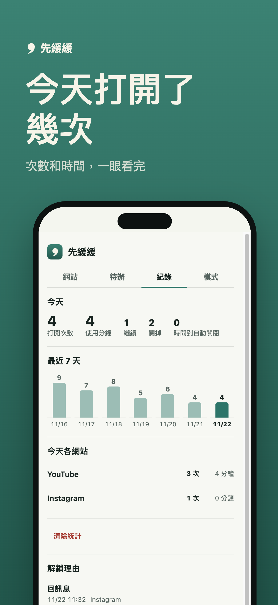
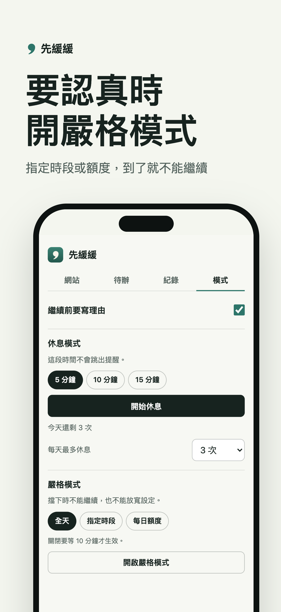
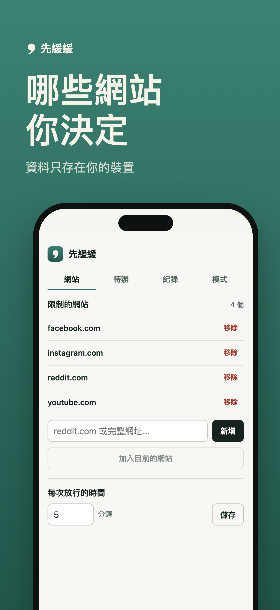
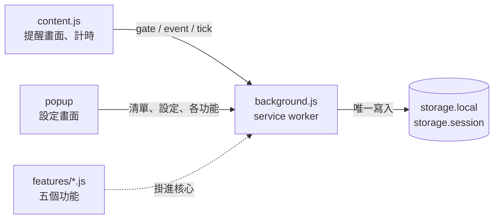

<div align="center">


# 先緩緩

**打開分心網站前，先停一下。**

Chrome 擴充功能，也有 iPhone 和 Mac 的 Safari 版。


</div>

<p align="center">
  
</p>

想滑一下社群，回過神來一小時就過去了。先緩緩會在你打開自己列出的網站時先蓋上一個提醒畫面：喝口水、看一下待辦、伸展 30 秒，再決定要不要繼續。

它不封鎖網站，只加一點摩擦。想繼續就等 10 秒，放行後用滿設定的時間，分頁會自動關閉。圖示是一個逗點，讀到逗點會停一下，但句子還沒結束。

## 功能

| 功能 | 做什麼 |
|---|---|
| **提醒畫面** | 預設提醒 Instagram、Facebook、YouTube，可以加任何網域，或只限制某個路徑（例如 `example.com/news`）。 |
| **放行時間** | 按「我真的要繼續」要先等 10 秒，放行後預設 5 分鐘自動關閉分頁。重新整理也照算，不會歸零。 |
| **待辦清單** | 提醒畫面會列出還沒做完的事，可以直接勾掉。沒有待辦時這一步就不出現。 |
| **分心統計** | 今天打開幾次、繼續幾次、用了多久，還有最近七天的長條圖。 |
| **解鎖理由** | 繼續之前寫下為什麼要打開，可以回頭看，也能匯出成 CSV。 |
| **休息模式** | 5 到 15 分鐘不跳提醒，每天有次數上限。 |
| **嚴格模式** | 全天、指定時段，或用完每日額度後就不能繼續。開著的時候不能移除網站或放寬設定，關閉要等 10 分鐘才生效。 |

<p align="center">
  
  
  
  
</p>

擴充功能可以在瀏覽器設定裡整個關掉，這點擋不住。它提供的是摩擦，不是鎖。

## 下載

| 平台 | 狀態 |
|---|---|
| Chrome | 還沒上架 Chrome Web Store，先[從原始碼安裝](#從原始碼安裝) |
| iPhone（Safari） | App Store 審核中 |
| Mac（Safari） | Mac App Store 審核中 |

## 從原始碼安裝

### Chrome

1. 下載或 clone 這個專案。
2. 打開 `chrome://extensions/`，開啟右上角的「開發人員模式」。
3. 按「載入未封裝項目」，選專案裡的 `extension` 資料夾。
4. 安裝後會開一個設定頁，按「授權清單中的網站」。

以前直接載入專案根目錄的舊版：先在 `chrome://extensions/` 移除，再照上面載入 `extension` 資料夾。資料夾換了，Chrome 會當成另一個擴充功能，原本的網站清單和時間上限不會帶過來，要重新設定。

### iPhone 和 Mac

需要 Mac 和 Xcode 27 以上，簽署和建置的步驟在 [ios/README.md](ios/README.md) 和 [mac/README.md](mac/README.md)。免費的 Personal Team 也能裝到自己的裝置上。

## 隱私

沒有帳號、沒有伺服器、沒有追蹤。網站清單、待辦和紀錄都只存在瀏覽器的 `storage.local`，擴充功能不發出任何網路請求。完整說明在 [PRIVACY.md](PRIVACY.md)。

用到的權限：

| 權限 | 用途 |
|---|---|
| `storage` | 存清單、設定、待辦和紀錄 |
| `scripting` | 只在你授權的網站上放提醒畫面 |
| `activeTab` | 按「加入目前的網站」時讀目前分頁的網址 |
| 網站權限（選用） | 只要求清單裡的網站，移除網站時一起收回 |

## 運作方式



- **一份程式，三個平台。** `extension/` 是唯一的擴充功能，Chrome 直接載入，iOS 和 macOS 的 Xcode 專案直接引用同一個資料夾。
- **背景程式是唯一寫入儲存的地方。** 每個頁面要不要蓋提醒、還剩多少時間，都由它決定，所以多個分頁不會互相蓋掉資料。放行的剩餘時間記在 `storage.session`，重新整理不會重置。
- **功能各自一個檔案。** 五個功能透過 `gate`、`finalize`、`guard`、`overlay`、`popup` 等掛勾接進核心。新增功能的寫法在 [docs/FEATURES.md](docs/FEATURES.md)。
- **只在授權的網站執行。** content script 用 `scripting.registerContentScripts` 動態註冊，只涵蓋你授權過的網站。

## 開發

需要 Node 20 以上。

```bash
npm install
```

```bash
npm test
```

- **單元測試**（`tests/unit/`）：在 Node 的 `vm` 裡跑真正的 `background.js`，搭配假的擴充功能 API。
- **端對端測試**（`tests/e2e/`）：用 Playwright 開無頭 Chromium 載入擴充功能，把每個功能實際點過一遍，網路請求一律回假頁面。第一次要先裝瀏覽器：

  ```bash
  npx playwright-core install chromium
  ```

```
extension/          擴充功能本體，三個平台共用
  core.js             共用工具與設定
  background.js       service worker
  content.js          提醒畫面與計時
  popup.html/js/css   設定畫面
  features/           五個功能，一個功能一個檔案
ios/                包住擴充功能的 iOS App
mac/                包住擴充功能的 macOS App
tests/              單元測試與端對端測試
scripts/            打包、簽署上傳、圖示與商店截圖
store-assets/       圖示與商店截圖
docs/               功能架構、發版流程、商店文案
```

常用腳本：

| 指令 | 做什麼 |
|---|---|
| `./scripts/package-chrome.sh` | 打包上架 Chrome Web Store 的 zip |
| `./scripts/ios-run.sh` | 建置並裝到接上的 iPhone |
| `./scripts/ios-archive.sh --upload` | 簽署 iOS 版並上傳 App Store Connect |
| `./scripts/mac-archive.sh --upload` | 簽署 Mac 版並上傳 App Store Connect |
| `node scripts/render-icons.js` | 從 `store-assets/icon/icon.svg` 產生各尺寸圖示 |
| `node scripts/render-store-screenshots.js` | 用真實介面產生商店截圖 |

發版流程（Chrome Web Store、TestFlight、App Store、Mac App Store）在 [docs/RELEASING.md](docs/RELEASING.md)，商店文案在 [docs/store-listing.md](docs/store-listing.md)。

## 回報問題

遇到問題或有想法，歡迎開 [issue](../../issues)。回報時附上瀏覽器和版本，重現的步驟寫得越清楚越好。
